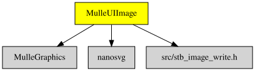

# MulleGraphicsImage

Part of [MulleUI](https://github.com/MulleUI) — UIKit-shaped modular GUI libraries for mulle-objc.

#### 🔆 Draw UIImages in layers

This library ties `UIImage` to the layer system and provides image file
formats. A `UIImage` becomes a `CGDrawable` and can be drawn by a
`CAImageLayer`, and `CGImage` as well as `UIBitmapImage` can be written out
as PNG, BMP or GIF.


| Release Version                                       | Release Notes  | AI Documentation
|-------------------------------------------------------|----------------|---------------
|  [](//github.com/MulleUI/MulleGraphicsImage/actions) | [RELEASENOTES](RELEASENOTES.md) | [DeepWiki for MulleGraphicsImage](https://deepwiki.com/MulleUI/MulleGraphicsImage)


## Documentation & Guides

* [API Summary](asset/dox/api/toc)
* [Coder Guide](asset/howto/coder/mulle-graphics-image)
* [Debugger Guide](asset/howto/debugger/mulle-graphics-image)
* [Verifier Guide](asset/howto/verifier/mulle-graphics-image)

## Usage

Load an image from disk and draw it in a `CAImageLayer`. Because MulleGraphicsImage
makes `UIImage` a `CGDrawable`, the layer renders it with its normal drawing
pipeline:

``` objc
#import <MulleGraphicsImage/MulleGraphicsImage.h>

static void   setupSceneInWindow( UIWindow *window)
{
   UIImage        *image;
   CAImageLayer   *layer;

   image = [UIImage imageWithContentsOfFileUTF8String:"parrot.png"];
   if( ! image)
      return;

   layer = [CAImageLayer layerWithFrame:[[window contentView] contentRect]];
   [layer setImage:image];

   [[window contentView] addSubview:[UIView viewWithLayer:layer]];
}
```

The concrete bitmap classes can also be written out in other formats:

``` objc
UIBitmapImage   *bitmap;

bitmap = (UIBitmapImage *) [UIImage imageWithContentsOfFileUTF8String:"parrot.png"];
[bitmap writeToBMPUTF8String:"parrot.bmp"];
[bitmap writeToGIFUTF8String:"parrot.gif"];
```

## Build the demo

The `demo/` folder is a [mulle-sde](//github.com/mulle-sde) project:

``` sh
cd demo
mulle-sde craft
```


### You are here




## Add

Use [mulle-sde](//github.com/mulle-sde) to add MulleGraphicsImage to your project:

``` sh
mulle-sde add github:MulleUI/MulleGraphicsImage
```

To only add the sources of MulleGraphicsImage with dependency
sources use [clib](https://github.com/clibs/clib):


``` sh
clib install --out src/MulleUI MulleUI/MulleGraphicsImage
```

Add `-isystem src/MulleUI` to your `CFLAGS` and compile all the sources that were downloaded with your project.


## Install

Use [mulle-sde](//github.com/mulle-sde) to build and install MulleGraphicsImage and all dependencies:

``` sh
mulle-sde install --prefix /usr/local \
   https://github.com/MulleUI/MulleGraphicsImage/archive/latest.tar.gz
```

### Legacy Installation

Install the requirements:

| Requirements                                 | Description
|----------------------------------------------|-----------------------
| [MulleGraphics](https://github.com/MulleUI/MulleGraphics)             | 🌠 MulleGraphics provides CALayer subclasses
| [MulleImage](https://github.com/MulleUI/MulleImage)             | 📸 MulleImage defines UIImage and provides some image file formats
| [mulle-objc-list](https://github.com/mulle-objc/mulle-objc-list)             | 📒 Lists mulle-objc runtime information contained in executables.

Download the latest [tar](https://github.com/MulleUI/MulleGraphicsImage/archive/refs/tags/latest.tar.gz) or [zip](https://github.com/MulleUI/MulleGraphicsImage/archive/refs/tags/latest.zip) archive and unpack it.

Install **MulleGraphicsImage** into `/usr/local` with [cmake](https://cmake.org):

``` sh
PREFIX_DIR="/usr/local"
cmake -B build                               \
      -DMULLE_SDK_PATH="${PREFIX_DIR}"       \
      -DCMAKE_INSTALL_PREFIX="${PREFIX_DIR}" \
      -DCMAKE_PREFIX_PATH="${PREFIX_DIR}"    \
      -DCMAKE_BUILD_TYPE=Release &&
cmake --build build --config Release &&
cmake --install build --config Release
```


## Author

[Nat!](https://mulle-kybernetik.com/weblog) for Mulle kybernetiK  


