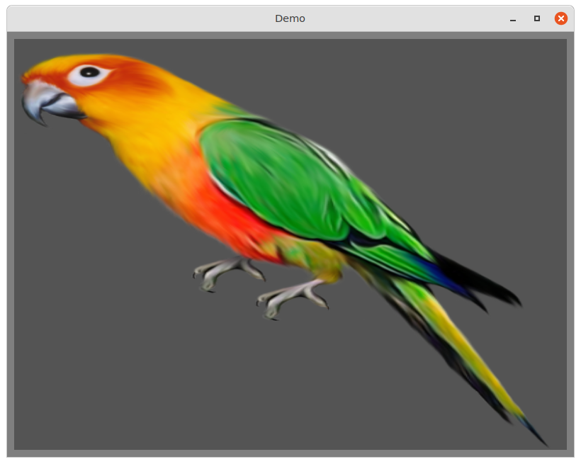
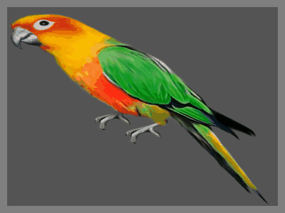

# demos

#### 👀 demos for MulleUIImage

The demos require MulleUI to run.

# uiimage

This demo reads a `parrot.jpg` file and displays it



# animatedgif

This demo creates 10 frames of a simple animation with `parrot.jpg` and
produces an animated GIF with them



## Build

This is a [mulle-sde](https://mulle-sde.github.io/) project.

It comes with its own virtual environment and list of dependencies.
To fetch and build everything say:

```
mulle-sde craft
```


# Art attribution

* [Retard Beaver by Yahya White](https://www.transparentpng.com/details/-images-animal-photos_6735.html)
* [Parrot by Yahya White](https://www.transparentpng.com/details/parrot-images-pictures-download_6733.html)